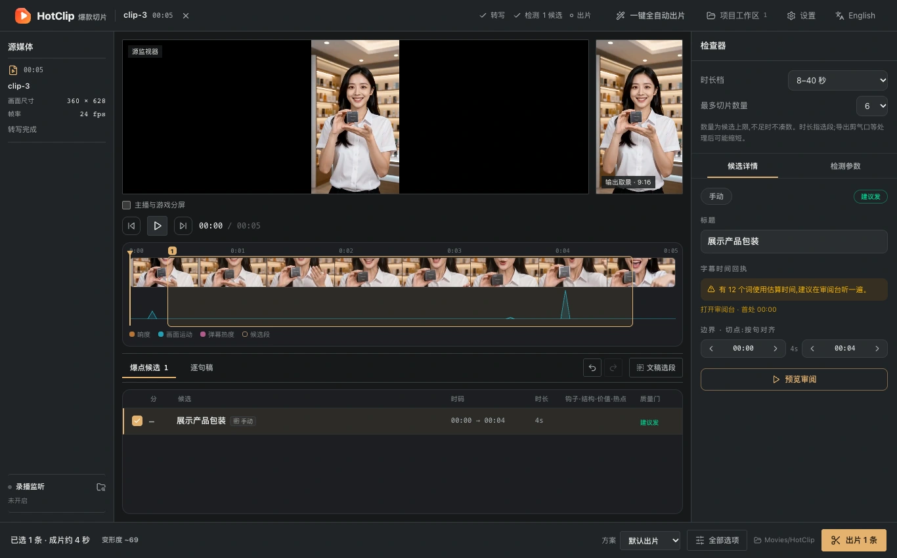

# HotClip v0.35.2

- 导入页并列呈现新素材和下一期栏目配方。可直接打开最近项目；首次使用时可查看项目自带的公开示例片。
- 工作台将源媒体信息、源监视器、输出取景、胶片时间线、检查器和出片操作区分开。已选择候选时，底部出片按钮是主要操作。
- 出片方案使用侧栏切换画面、剪辑、音频、字幕、发布和栏目配方；音乐和水印继续独立绑定。支持系统浅深色、窄窗重排、键盘方向键切换分类与 Esc 返回。
- 短素材的时间尺显示秒级刻度。截图使用仓库自带 clip-3.mp4 的实际画面、胶片带和运动曲线，选段为人工标注。

## English

- Open media and episode recipes side by side. Resume a recent project or view the public sample footage.
- Inspect the source, output framing, filmstrip and selected cut in separate regions. Once a cut is selected, Export is the primary action.
- The export console groups picture, edit, audio, caption, delivery and recipe settings. Music and watermark bindings stay independent. Follow system light/dark mode, use arrow keys to move between sections and Escape to return.
- Short clips now show second-level ruler marks. The image uses real frames from the bundled five-second demo, with a manually selected cut.
